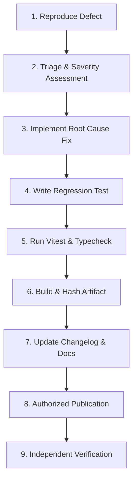

# Fern Client — Maintenance & Patch Release Workflow (Phase 24)

This workflow defines the operational protocol for triaging, reproducing, patching, and releasing future maintenance updates (e.g. `v1.0.1`) following the public launch of Fern Client v1.0.0.

> [!IMPORTANT]
> **Strict Release Gate**: A maintenance release must NEVER be published without a reproducible defect, a root-cause fix, an automated regression test, and explicit stakeholder authorization. Do not publish empty or speculative version increments.

---

## 9-Step Maintenance Workflow



### Step 1: Issue Reproduction
1. Extract reproduction steps from the GitHub Issue (using the [Bug Report template](file:///.github/ISSUE_TEMPLATE/bug_report.yml)).
2. Reproduce the defect in an isolated clean environment matching the user's Windows build and Java runtime.
3. Verify that the failure is reproducible and not caused by unredacted third-party file tampering.

### Step 2: Severity & Impact Triage
Assign severity based on the objective matrix:
- **P0 — Critical**: Data loss, credential compromise, launcher unable to open, or total launch failure across all profiles. Hotfix initiated immediately.
- **P1 — High**: Specific mod loader failure (e.g., Fabric on 1.21.4), JVM argument parse failure, or crash on common hardware. Target next maintenance patch.
- **P2 — Medium**: Cosmetic HUD alignment defect, minor localization glitch, or secondary UI error that has a functional workaround. Scheduled in standard milestone.
- **P3 — Low**: Documentation typo, optional theme enhancement, minor non-blocking issue.

### Step 3: Implement Root Cause Fix
1. Create a dedicated maintenance branch: `fix/issue-<number>-<slug>`.
2. Apply surgical code fixes directly at the root cause.
3. Ensure no backward-incompatible changes are made to user configs in `%APPDATA%/Fern Client` or `./data`.

### Step 4: Add Automated Regression Test
1. Add a targeted test in `tests/` specifically recreating the condition that caused the bug.
2. Confirm the test fails before the fix and passes after the fix.

### Step 5: Test Suite Execution & Quality Verification
Run the comprehensive verification commands:
```powershell
npm run typecheck
npm run verify:docs
npm test
```
All test suites must pass (100% green).

### Step 6: Build & Verify Release Artifact
1. Compile production bundles:
   ```powershell
   npm run build
   ```
2. Package Windows release bundle:
   ```powershell
   npm run package:win
   ```
3. Recompute SHA-256 and generate release manifest:
   ```powershell
   node -e "import('./scripts/release-pipeline.ts').then(m => new m.ReleasePipeline().buildReleaseManifest('<NEW_VERSION>', './release'))"
   ```
4. Verify portable ZIP integrity and byte size.

### Step 7: Update Changelog & Distribution Metadata
1. Document changes in `CHANGELOG.md` and [`release/RELEASE_NOTES.md`](file:///d:/Fern%20Client/release/RELEASE_NOTES.md).
2. Update [`website/src/data/release-metadata.ts`](file:///d:/Fern%20Client/website/src/data/release-metadata.ts) and [`packaging/distribution.json`](file:///d:/Fern%20Client/packaging/distribution.json).
3. Rebuild website: `npm run build:website`.

### Step 8: Authorized Publication
1. Confirm explicit approval for public release.
2. Commit and push tagged commit:
   ```powershell
   git tag -a v<NEW_VERSION> -m "Release v<NEW_VERSION>"
   git push origin v<NEW_VERSION>
   ```
3. Publish to GitHub Releases:
   ```powershell
   gh release create v<NEW_VERSION> "release/FernClient-<NEW_VERSION>-Portable.zip" "release/SHA256SUMS.txt" --title "Fern Client v<NEW_VERSION>" --notes-file "release/RELEASE_NOTES.md"
   ```

### Step 9: Independent Verification
1. Download the newly published artifact via public unauthenticated HTTP endpoint.
2. Verify byte-for-byte SHA-256 match with the local build artifact.
3. Test extraction and first startup in a clean folder.
